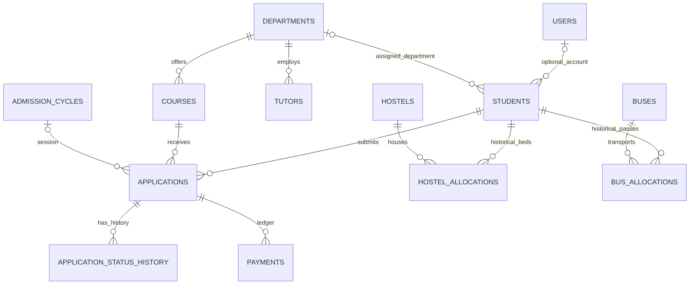

# ER diagram

Admins, announcements and audit_logs support the portal independently. Optional foreign keys may be NULL. Historical allocations permit multiple rows over time; generated unique keys permit only one active row per student for each facility type. Applications permit one approved admission per student.
